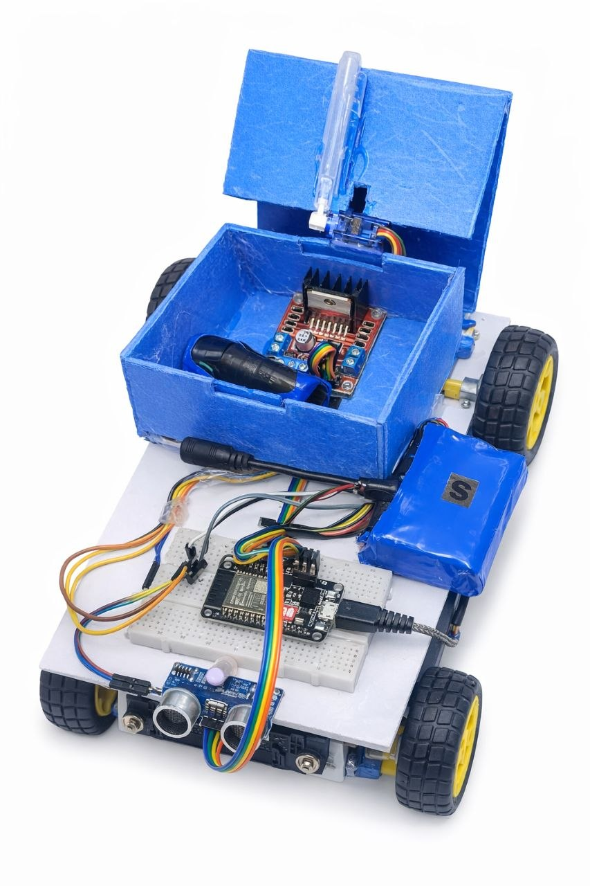

# Smart Bin Controlled Using ESP32 and Telegram Bot

## Project Overview
This project was developed during my 3-2 semester as part of my Electronics and Communication Engineering studies.

It uses an ESP32 microcontroller and a Telegram Bot for remote control over Wi-Fi. An ultrasonic sensor is used for distance detection, a motor driver controls the BO motors, and a servo motor operates the bin lid.

## Components Used
- ESP32 Microcontroller
- L298N Motor Driver
- HC-SR04 Ultrasonic Sensor
- SG90 Servo Motor
- BO Motors and Wheels
- Battery Pack
- ON/OFF Switch
- Jumper Wires

## Key Features
- Wi-Fi-based control using Telegram Bot
- Ultrasonic distance detection
- Motorized movement
- Servo-controlled lid

## Circuit Diagram
## Circuit Diagram

## Project Prototype

## Technologies Used
- Arduino IDE
- Embedded C/C++
- ESP32
- Internet of Things (IoT)
- Telegram Bot

## Learning Outcomes
- Microcontroller programming
- Sensor interfacing
- Motor control
- Hardware and software integration

## Author
Shashank  
Electronics and Communication Engineering
